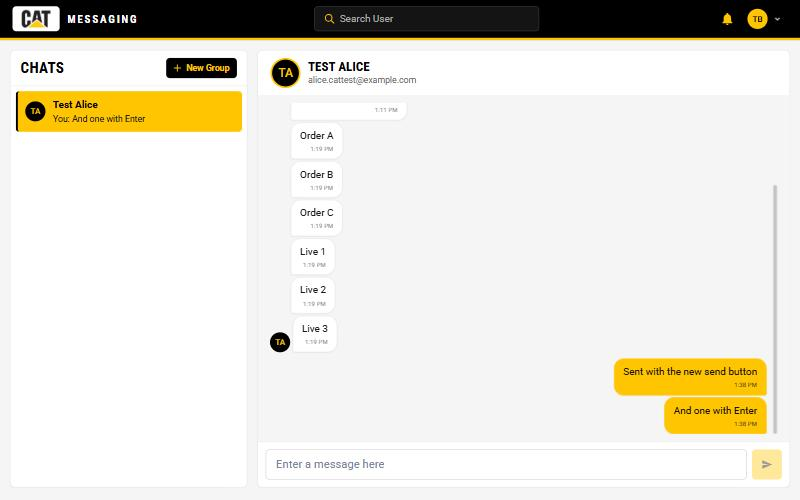
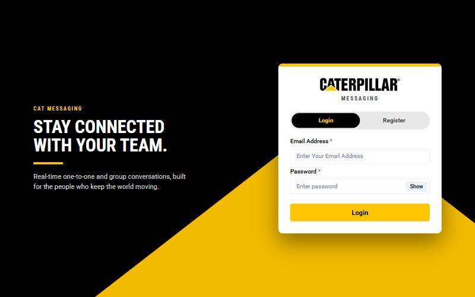
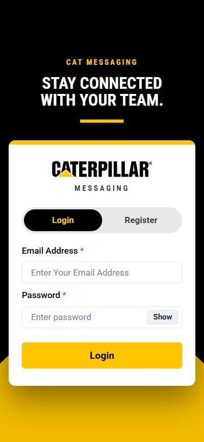
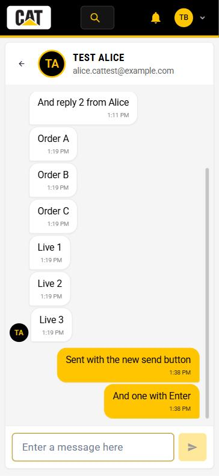

# CAT Messaging: Client

A real-time team chat web app with one-to-one and group conversations, styled with the Caterpillar colour scheme. This repository is the **React front end**. It talks to the companion API and socket server in **[cat-messaging-server](https://github.com/manoharhunt25/cat-messaging-server)**.



| Login | Login (phone) | Chat (phone) |
|---|---|---|
|  |  |  |

## Features

- **Accounts:** register, log in and log out. Sessions use a JWT stored in the browser.
- **One-to-one chat:** search users by name and start a conversation.
- **Group chat:** create groups of 3 or more people, then rename them and add or remove members. Admin-only actions are checked in the app, and anyone can leave a group.
- **Real time:** messages arrive instantly over Socket.IO, without refreshing.
- **Notifications:** a bell with an unread count for messages in chats you don't have open, and one click jumps to the chat.
- **Chat list:** shows each chat's latest message preview, with the open chat highlighted.
- **Responsive:** side-by-side panels on desktop; list and chat screens with a back button on phones.

## Tech stack

| Area | Library |
|---|---|
| UI | React 18, [Chakra UI](https://chakra-ui.com/) 2 with a custom theme |
| Routing | React Router 6 |
| HTTP | Axios |
| Real time | socket.io-client 4 |
| Build and tests | Create React App 5 (`react-scripts`), Jest, React Testing Library |

## Getting started

### Prerequisites

- **Node.js 18 or newer**, tested on Node 26
- The **[cat-messaging-server](https://github.com/manoharhunt25/cat-messaging-server)** running, by default on `http://localhost:4000`. Use an up-to-date copy: the client logs in to the server's real-time connection with its token, which older server versions don't support.

### Install and run

```bash
git clone https://github.com/manoharhunt25/cat-messaging-client.git
cd cat-messaging-client
npm install
npm start
```

The app opens at **http://localhost:3000**.

> **Use port 3000.** The server only accepts real-time (Socket.IO) connections from `http://localhost:3000`. On any other port, messages won't arrive live.

### Configuration

The backend address comes from one environment variable. Copy the example file and edit it if your server isn't on `localhost:4000`:

```bash
cp .env.example .env
```

| Variable | Default | Purpose |
|---|---|---|
| `REACT_APP_API_URL` | `http://localhost:4000` | Base URL of the REST API and Socket.IO server |

The value is read at build time, so restart `npm start` or rebuild after changing it.

## Scripts

| Command | What it does |
|---|---|
| `npm start` | Development server with live reload at http://localhost:3000 |
| `npm run build` | Optimised production build in `build/` |
| `npm test` | Runs the test suite in watch mode (`CI=true npm test` runs it once) |

To try the production build locally:

```bash
npm run build
npx serve -s build -l 3000
```

## Project structure

```
public/
  brand/                 Caterpillar logo files used in the UI
  index.html             Page title, fonts and icons
src/
  theme.js               Chakra theme: brand colours, fonts, button and tab styles
  config.js              Reads REACT_APP_API_URL
  App.js                 Routes: "/" (login) and "/chats"
  Pages/
    Homepage.js          Login and registration screen
    ChatPage.js          Main layout: header, chat list and chat panel
  Components/
    ChatProvider.js      React context: logged-in user, chats, selected chat, notifications
    SideDrawer.js        Header bar, user search drawer, notifications, profile menu and logout
    MyChats.js           Chat list with latest-message previews
    ChatBox.js           Container for the open chat
    SingleChat.js        Chat header, messages, composer and the Socket.IO connection
    ScrollableChat.js    Message bubbles
    ChatLogics.js        Helpers for grouping, ordering and labelling messages
    GroupChatModal.js    "New group" dialog
    UpdateGroupChatModal.js  Group settings: rename, members, leave
    UserListItem.js, UserBadgeItem.js, ChatLoading.js, Icons.js
docs/screenshots/        Images used in this README
```

## Design

The interface follows the Caterpillar palette, defined in [`src/theme.js`](src/theme.js):

| Colour | Hex | Used for |
|---|---|---|
| Golden Poppy | `#FFC500` | Primary buttons, your messages, selection, accents |
| Black | `#000000` | Header, secondary buttons, avatars |
| White | `#FFFFFF` | Cards, panels, other people's messages |

Headings use Roboto Condensed and body text uses Roboto, both loaded from Google Fonts. To restyle the app, change the theme file rather than individual components.

## Testing

```bash
CI=true npm test
```

The suite covers routing and redirects for logged-out users, logout, the API URL setting, and the message helpers (grouping, ordering and de-duplication). The API and socket are mocked, so no server is needed.

## Known limitations

- **No attachments:** messages are text only.
- **No typing indicator** or read receipts yet.
- **Create React App is no longer maintained.** It works today, but moving to Vite is the long-term option.

## Trademarks

"CAT", "Caterpillar", the Caterpillar logos and "Caterpillar Yellow" trade dress are trademarks of Caterpillar Inc. They appear here only for the branding of this project. The source code doesn't grant any rights to use them.
